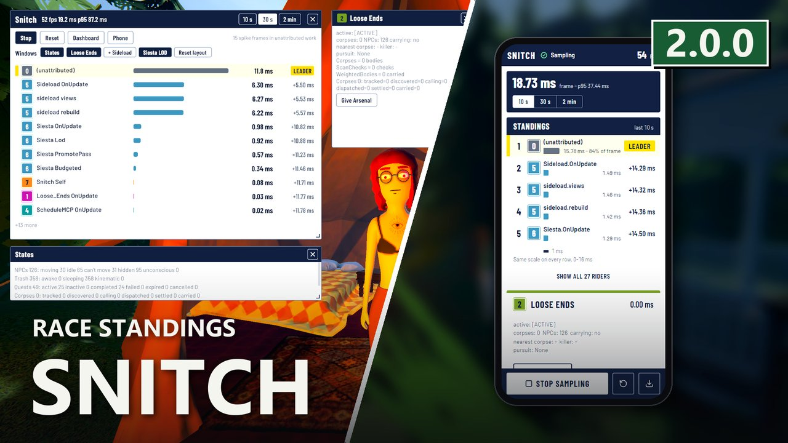
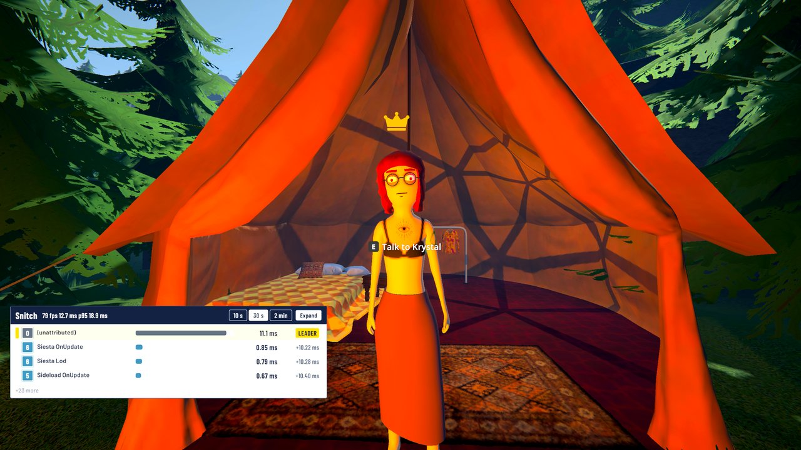
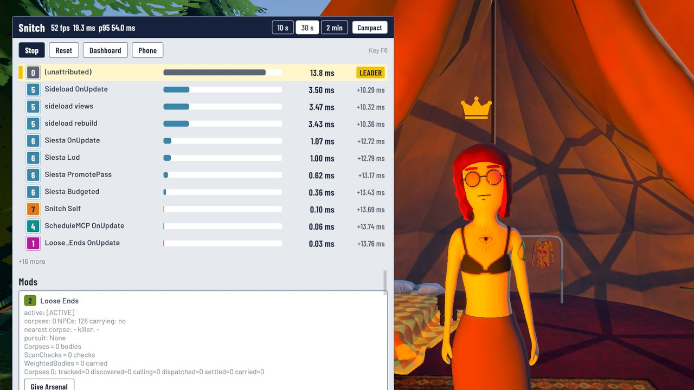
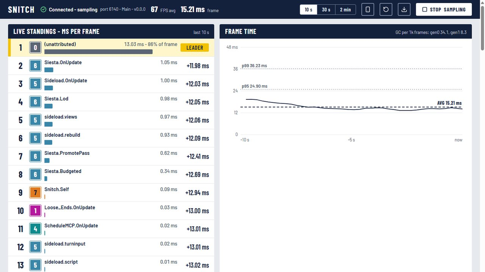
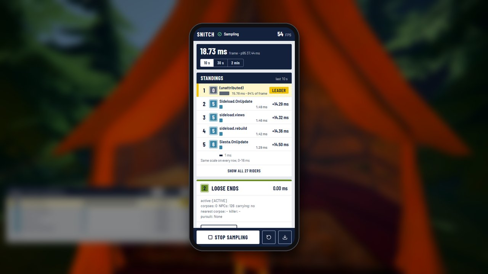

# Snitch

**A performance profiler for Schedule I** - measure what's actually slow, then make it fast.

> 🛟 **Need help or found a bug?** Get support at [support.doodesch.de/snitch](https://support.doodesch.de/snitch).

**Download:** [Nexus Mods](https://www.nexusmods.com/schedule1/mods/2222) · [Thunderstore](https://thunderstore.io/c/schedule-i/p/DooDesch/Snitch/) · [GitHub Releases](https://github.com/DooDesch-Mods/ScheduleOne-Snitch/releases)

📖 **API documentation:** [docs.doodesch.de/mods/snitch/api/](https://docs.doodesch.de/mods/snitch/api/)

> Snitch measures the **cost** and **state** of NPCs, trash, quests, and - through a tiny no-op API built on
> [S1API](https://github.com/ifBars/S1API) - any other mod's systems. Its in-game overlay is a
> race-standings table (a compact lower-third, expandable to every mod's panel),
> alongside a combined log timeline and a live **[web dashboard](https://snitch.doodesch.de)** so you can see
> frame times, section costs, and entity-state distributions in real time.


[](https://mods.doodesch.de) [](https://polyfill.doomods.com/mod/snitch)

[](https://mlvscan.com/attestations/att_oAb-DnqwKyqFBZJh8lRvZxe_)



**[Live dashboard](https://snitch.doodesch.de)** · **[Documentation](https://docs.doodesch.de/mods/snitch/)** · **[Modder example](https://github.com/DooDesch-Mods/ScheduleOne-SnitchExample)** · **[Dashboard source](https://github.com/DooDesch-Mods/ScheduleOne-SnitchWeb)** · **[Support](https://support.doodesch.de/snitch)**

## Features

- **Frame time** distribution + fps + GC pressure - the load-bearing, build-independent truth.
- **Section costs** - time named code sections (yours via the API, or vanilla hot paths like `NPCMovement.Update`).
- **Unattributed time** - the part of a frame that ran inside no section at all, reported as its own line. When a frame is far worse than the median and the sections did not grow with it, Snitch says so instead of implying the rest is fine.
- **Stutter causes** - every step of the engine's frame is timed, so each stutter is named: the mod that caused it (its OnUpdate, Harmony patch, MonoBehaviour or coroutine), a garbage collection with the mod that made most of the garbage, or the kind of game work (scripts, rendering, physics, loading, ...). The overlay shows the last stutter and its cause.
- **Harmony patch timing** - opt-in wrapping of every other mod's prefixes, postfixes and finalizers, so per-frame cost that lives in a patch on a vanilla method shows up under the mod that owns it.
- **State distributions** - NPCs by movement/visibility, trash by physics state, quests by state, and your own.
- **Per-mod panels** - any mod that reports data gets its own panel (counters, state, text, action buttons, toggles) in the expanded in-game overlay and the web dashboard.
- **Log timeline** - a combined, chronological view of every mod's log output, with per-mod filtering.
- **Ablation A/B** - toggle a subsystem off and measure the real frame-time delta (the causal "total cost").
- **[Live web dashboard](https://snitch.doodesch.de)** - opens straight to your local game over WebSocket; your telemetry never leaves your PC.
- **Phone remote** - scan a QR (in the dashboard or the in-game Snitch panel) to drive the profiler from your phone: live FPS, Start/Stop/Reset, and every mod's actions and toggles. Works on the same Wi-Fi or across networks, end-to-end encrypted.
- **Honest** - every number self-certifies; Snitch even reports its own overhead (`Snitch.Self`).
- **Modder API** - a zero-overhead no-op when Snitch isn't installed, so you can ship it with no hard dependency.

## Screenshots

| | |
|---|---|
|  |  |
| Compact overlay (F6): leader and gaps on one shared ms scale | Expanded overlay: every mod's rows and panel |
|  |  |
| Web dashboard with the same bibs and colours | Phone remote |

## Requirements

| Requirement | Version / Notes |
|---|---|
| Schedule I | IL2CPP build |
| MelonLoader | 0.7.x |
| S1API | `ifBars-S1API_Forked` |
| [Sideload](https://www.nexusmods.com/schedule1/mods/2360) 1.36.1+ | Draws the in-game overlay (auto-installed as a dependency). |

## Installation

### Recommended: Nexus Mods

1. Install **MelonLoader 0.7.x** for Schedule I ([melonwiki.xyz](https://melonwiki.xyz/)).
2. Download Snitch from [Nexus Mods](https://www.nexusmods.com/schedule1/mods/2222) and install it with Vortex,
   or put **`Snitch.dll`** into your Schedule I `Mods/` folder.
3. Get **S1API** and [Sideload](https://www.nexusmods.com/schedule1/mods/2360) 1.36.1 or newer the same way.

### Thunderstore mod manager

Install Snitch from the [Thunderstore page](https://thunderstore.io/c/schedule-i/p/DooDesch/Snitch/) with r2modman / Gale; the dependencies (MelonLoader, S1API, Sideload)
pull in automatically.

### Manual

Install MelonLoader 0.7.x, S1API and Sideload 1.36.1 or newer, then drop `Snitch.dll` into the game's `Mods/` folder.

## Configuration

Settings live in `UserData/MelonPreferences.cfg` under `Snitch_01_Main` (or the in-game Mod Manager UI). The
profiler is idle until you run `snitch start`.

| Setting | Default | What it does |
|---|---|---|
| `Enabled` | `true` | Master switch. OFF = Snitch does nothing. |
| `EnableInMultiplayer` | `true` | Profiling runs locally on every peer; state-mutating levers stay host-only. |
| `AutoStart` | `false` | Begin sampling automatically on world load. |
| `TimeModPatches` | `true` | Also time other mods' Harmony patches, so a stutter inside a patch is charged to its mod. The wrappers go in a few per frame after `snitch start`. |
| `SpikeFactor` | `1.5` | How much worse than the window median a frame has to be to count as a bad frame in the unattributed report. |
| `PollHz` | `4` | How often state providers + counters are sampled (frame-time is every frame). |
| `ServerEnabled` | `true` | Run the loopback data server for the web dashboard. |
| `ServerPort` | `6140` | The loopback port (127.0.0.1 only). |
| `ServerToken` | `(empty)` | Optional pairing token for the dashboard. |
| `AllowedOrigins` | `https://snitch.doodesch.de` | Web origins allowed to connect from the browser (localhost is always allowed). |

## Usage

The in-game overlay is a Sideload surface of Snitch's own - press
**F6** (preference `OverlayKey`) to step hidden, compact standings, expanded; `snitch open` / `snitch open all` / `snitch close` do the same.

Expanded is a set of windows: Standings (the rows, Start/Stop, Reset, Dashboard, Phone), States, and one window per mod with its panel. Drag a window by its title bar, resize it from the grip in the bottom-right corner, click it to bring it to the front, close it with its x. The Windows strip in Standings reopens closed windows and has Reset layout (console: `snitch layout reset`). Positions, sizes and open state are remembered (preference `OverlayLayout`). The compact card is moved by holding Alt and dragging its header.

Snitch's own console:

- `snitch layout reset` - restore the default window layout.
- `snitch start` / `snitch stop` - arm / disarm sampling (or the Start/Stop buttons in the expanded overlay).
- `snitch panels` - list the per-mod panels (shown in the expanded overlay).
- `snitch act <id>` / `snitch toggle <id>` / `snitch log [<channel>|all]` - run a panel action, flip a toggle, or read the logs.
- `snitch top` / `snitch sections` / `snitch states` / `snitch counters` - log the current numbers.
- `snitch unattributed` - how much of the frame no section explains, and how much of the bad frames it accounts for.
- `snitch engine [n]` - the engine's own work by kind and the stutters of the last 60 s with their cause (`snitch engine map` lists every engine step and its kind).
- `snitch deep on` / `off` - time the game's own scripts by class, so a stutter in game code names the class. Costs frame time while on.
- `snitch patches on` / `off` / `list` - time every other mod's Harmony prefixes, postfixes and finalizers (on with sampling by default).
- `snitch garbage` - which mod made the garbage since the last collection, on the game heap and the .NET heap.
- `snitch vanilla on` - attribute CPU cost to vanilla hot paths (e.g. `NPCMovement.Update/FixedUpdate`).
- `snitch ablate <lever>` - measure a subsystem's causal frame cost (built-in `npc` lever; `snitch levers` lists them).
- `snitch report [md|csv|all]` - export to `Mods/Snitch/runs/`.

Or open the **web dashboard** at **[snitch.doodesch.de](https://snitch.doodesch.de)** (or the copy bundled
offline at `http://localhost:6140/`) - it auto-connects and shows frame times, section costs, and state
distributions live.

## For modders

Your mod's per-frame methods (`OnUpdate` etc.) are **auto-timed with zero code** - it just appears as
`<YourMod>.OnUpdate` once Snitch is sampling. To go further, drop in `Snitch.cs` (or reference
`Snitch.Api.dll`) - a zero-overhead no-op when Snitch isn't installed - and either name a class `SnitchProbe`
with a static `Register()` (auto-discovered, no wiring). There you can build your own **panel** - counters,
state, free text, action buttons, toggles and a log channel, shown in the expanded in-game overlay and the web dashboard:

```csharp
using Snitch.Api;   // Profiler, Panel, StateSnapshot
Panel p = Profiler.RegisterPanel("MyMod", "My Mod");
p.Counter("QueueLength", () => _q.Count, "items");                // a numeric gauge
p.State("Jobs", () => new StateSnapshot { Title = "Jobs" }.Add("running", _r)); // a distribution
p.Action("Flush", () => Flush());                                 // a button (replaces a debug hotkey)
p.Toggle("Verbose", () => _v, x => _v = x);                       // an on/off control
p.Log();                                                          // show this panel's log channel
using (Profiler.Sample("MyMod.Pathfinding")) { ... }              // hand-time a sub-section
```

See the **[SnitchExample](https://github.com/DooDesch-Mods/ScheduleOne-SnitchExample)** mod for the full
surface, and the **[Modder API documentation page](https://docs.doodesch.de/mods/snitch/guides/modder-api/)**.

## When the numbers do not add up

Snitch used to report only what it happened to wrap, and silence read exactly like "this mod is cheap".

It is not. A mod's most expensive per-frame work does not have to live in `OnUpdate`. It can sit in a Harmony
postfix on a vanilla method the engine calls every frame, in a coroutine, in an event handler, or in a Unity
message on a `MonoBehaviour` the mod added - none of which any section covers.

So every frame Snitch now also records what the frame cost against what the sections accounted for, and reports
the difference as **`(unattributed)`** - a row in the section list (the "Game" row in the overlay), a line in the
report, a field on the dashboard. Most of it is the game itself and always will be. The number that points at a mod is the bad-frame
split:

```
snitch unattributed
unattributed: 4.12 ms/frame of a 6.53 ms frame (63%) - inside no section at all.
  sections account for 2.41 ms/frame; the worst single frame left 18.90 ms unexplained.
  bad frames: 7 of 120 above 1.5x the 6.10 ms median; on those, 8.32 ms of the 9.10 ms excess (91%) is unexplained.
  -> mod patches (252), MonoBehaviours and coroutines are timed and still nothing accounts for it. ...
```

When a frame is far worse than the median and the sections did not grow with it, the extra milliseconds are
running somewhere the profiler does not reach - and that is a fact worth acting on, not a gap to fill in later.

### Stutters

Snitch also times each step of the engine's frame (scripts, coroutines, rendering, physics, animation, NPC
navigation, UI, loading, audio, the wait for the GPU). The steps add up to the whole frame, so a stutter always has
a name. Each one is blamed on one cause, in this order:

1. a section that grew by at least half the frame's excess: a mod's OnUpdate, one of its Harmony patches, a
   MonoBehaviour it added, one of its coroutines, or a game class with `snitch deep on`,
2. a garbage collection of the game heap in that frame, named after the mod that made most of its garbage,
3. a .NET garbage collection (only mods and the loader allocate there), named the same way,
4. the kind of engine work that grew most, with the mod whose sections grew with it, if any.

Garbage is counted per section: every allocation is charged to the section it happened in, and a collection
ends the count. A mod that made at least 20% of a collection's garbage is named as its maker. `snitch garbage`
shows the running count.

The compact overlay shows `Last stutter: <ms> - <cause>` and a count per cause. The game's own work is the grey
Game block below the mods, one row per kind of engine work (Scripts without the mods' share, Rendering, Physics,
...); it never takes the LEADER place. The log gets one `[snitch] stutter` line per stutter:

```
[snitch] stutter 61.2 ms (median 11.4) GC x1 cause: Garbage collection +48.3 | mod: Chassis | garbage since the last collection 38.1 MB: Chassis 21.4 MB (56%), (outside mod code) 12.2 MB (32%), ... | steps: ...
```

When the game's own scripts or coroutines ran long and no mod is to blame, the line ends its cause with
`'snitch deep on' names the class`. With `snitch deep on` the same stutter names the game class, for example
`cause: Game.NPCMovement.Update`.

### Mod patches, MonoBehaviours and coroutines

A mod's per-frame work does not have to live in OnUpdate. While sampling, Snitch also times every prefix,
postfix and finalizer that belongs to a loaded mod, the Update, LateUpdate, FixedUpdate and OnGUI of every
MonoBehaviour a mod adds, and every coroutine a mod runs. Each is labelled after its mod, so a stutter in it names
the mod. The wrappers go in a few per frame after `snitch start` instead of as one long hitch. `snitch patches list` shows what was wrapped, what
it costs and which methods it patches; `snitch patches status` names every patch that was left alone and why.

What it costs and what to know:

- A dictionary lookup on both sides of every call. On a 12-mod stack with 252 wrapped patches the median frame
  did not change.
- A Harmony patch that fails leaves its target broken for every later patcher. Every failure is logged as an
  error and listed by `snitch patches status`; `snitch patches off` (or preference `TimeModPatches`) turns it off.
- It is a snapshot of Harmony's patch table. Run `snitch patches on` again after a mod that patches late has loaded.

Wrapped patches carry the wrapper's own overhead, the same as the vanilla probes.

## How it works

ProfilerRecorder engine counters are inert in Schedule I's IL2CPP build, so Snitch relies on **frame-time +
GC** as the truth and **self-measured section timing** (Harmony accumulators) for attribution. The web
dashboard ([snitch.doodesch.de](https://snitch.doodesch.de), source at
[ScheduleOne-SnitchWeb](https://github.com/DooDesch-Mods/ScheduleOne-SnitchWeb)) is served both from that
hosted site and bundled inside the mod for offline use; either way the page connects straight to
`ws://127.0.0.1:6140` so your data stays on your machine.

## Compatibility

Profiling is read-only and safe alongside other mods (it even observes their effects). State-mutating features
(the ablation levers) run host-only in multiplayer. The profiler stays idle until you run `snitch start`.

## Community

[](https://mods.doodesch.de)

Join the DooDesch Mods Discord: update pings, polls on what comes next, and playtests of new mods.

## Credits

Built by DooDesch on [S1API](https://github.com/ifBars/S1API) by ifBars.

## License

DooDesch API License - build on the API, do not copy the code. See [LICENSE.md](LICENSE.md).

This mod is written with help from generative AI tools (Anthropic Claude, OpenAI Codex).
