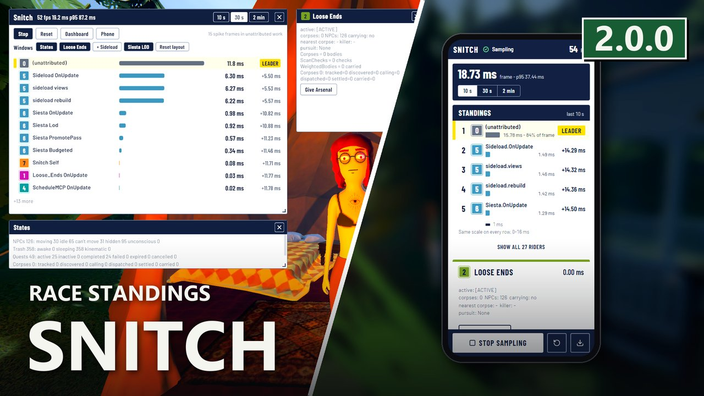
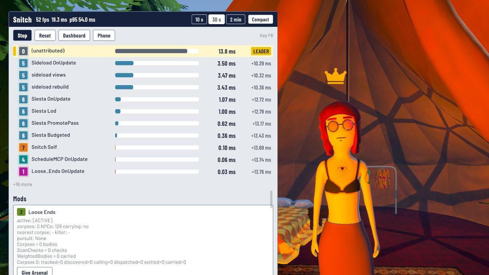
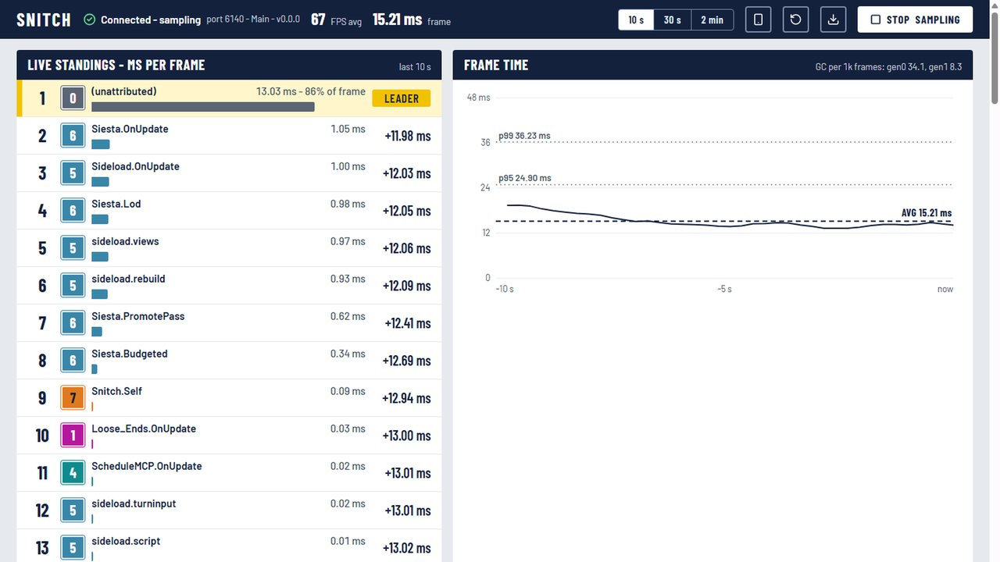

# Snitch

**A performance profiler for Schedule I** - find out what's actually slow.

> 🛟 **Need help or found a bug?** Get support at [support.doodesch.de/snitch](https://support.doodesch.de/snitch).

Snitch measures the **cost** and **state** of NPCs, trash, quests, and - through a tiny no-op API - any other
mod's systems. Its in-game overlay is a race-standings table (compact, expandable to each mod's panel), alongside a
combined log timeline and a live **web dashboard** so you can see frame times, section costs, and entity-state
distributions in real time, and make your mod (or vanilla gameplay) faster.


[](https://polyfill.doomods.com/mod/snitch)

[](https://mlvscan.com/attestations/att_NBSidR_Xcg6VMwpaUbsBZScO)



**[Live dashboard](https://snitch.doodesch.de)** · **[Wiki / docs](https://github.com/DooDesch-Mods/ScheduleOne-Snitch/wiki)** · **[Modder example](https://github.com/DooDesch-Mods/ScheduleOne-SnitchExample)** · **[Support](https://support.doodesch.de/snitch)**

## Features

- **Frame time** distribution + fps + GC pressure - the load-bearing, build-independent truth.
- **Section costs** - time named code sections (yours, or vanilla hot paths like `NPCMovement.Update`).
- **Unattributed time** - an `(unattributed)` row for the part of a frame that ran inside no section at all, and how much of your worst frames it cannot explain.
- **Harmony patch timing** - `snitch patches on` times every other mod's prefixes, postfixes and finalizers under the mod that owns them.
- **State distributions** - NPCs by movement/visibility, trash by physics state, quests by state, + your own.
- **Per-mod panels** - each mod that reports data gets its own toggleable, movable, resizable panel (counters, state, text, buttons, toggles).
- **Log timeline** - a combined, chronological view of every mod's log output, filterable per mod.
- **Ablation A/B** - toggle a subsystem off and measure the real frame-time delta (causal "total cost").
- **[Live web dashboard](https://snitch.doodesch.de)** - opens straight to your local game over WebSocket; telemetry never leaves your PC.
- **Phone remote** - scan a QR (dashboard or in-game panel) to drive the profiler from your phone: FPS, Start/Stop/Reset, and every mod's actions and toggles. Same Wi-Fi or across networks, end-to-end encrypted.
- **Honest** - every number self-certifies; Snitch even reports its own overhead.
- **Modder API** - a zero-overhead no-op when Snitch isn't installed; no hard dependency.

## Screenshots




## Requirements

| Requirement | Notes |
|---|---|
| MelonLoader | 0.7.x (IL2CPP) |
| S1API | `ifBars-S1API_Forked` |
| Sideload 1.36.1+ | Draws the in-game overlay (auto-installed as a dependency). |

## Use it

Press **F6** (preference `OverlayKey`) to step the overlay through hidden, compact standings and expanded. Expanded is a set
of windows - Standings, States and one per mod - that you drag by the title bar, resize from the bottom-right grip and
close or reopen from the Windows strip; the layout is remembered and `snitch layout reset` restores it. Hold Alt and drag
the header to move the compact card. Then `snitch start` (or the Start button). Or open the web
dashboard at **[snitch.doodesch.de](https://snitch.doodesch.de)** - it auto-connects and shows everything live.
Console verbs: `layout reset, start, stop, status, frame, top, sections, states, counters, unattributed,
patches on|off|list, panels, act, toggle, log, vanilla on|off, ablate <lever>, levers, report`.
Reports go to `Mods/Snitch/runs/`.

## For modders

Your mod's `OnUpdate` etc. are auto-timed with zero code (`<YourMod>.OnUpdate`). For more, drop in `Snitch.cs`
(or reference `Snitch.Api.dll`) - a no-op when Snitch isn't installed:

```csharp
using Snitch.Api;   // Profiler, Panel, StateSnapshot
Panel p = Profiler.RegisterPanel("MyMod", "My Mod");             // your own panel in the overlay + dashboard
p.Counter("Queue", () => _q.Count, "items");                     // a gauge
p.Action("Flush", () => Flush());                                // a button (replaces a debug hotkey)
p.Toggle("Verbose", () => _v, x => _v = x);                      // an on/off control
using (Profiler.Sample("MyMod.Work")) { ... }                    // hand-time a sub-section
```

Or just name a class `SnitchProbe` with a static `Register()` - Snitch discovers and calls it automatically.
Full example: **[ScheduleOne-SnitchExample](https://github.com/DooDesch-Mods/ScheduleOne-SnitchExample)**.

## Notes

ProfilerRecorder engine counters are inert in Schedule I's IL2CPP build, so Snitch relies on frame-time + GC
and self-measured section timing. Profiling is local and safe in multiplayer; state-mutating features run
host-only. Everything is idle until you `snitch start`.

## Credits

Built by DooDesch on [S1API](https://github.com/ifBars/S1API).
